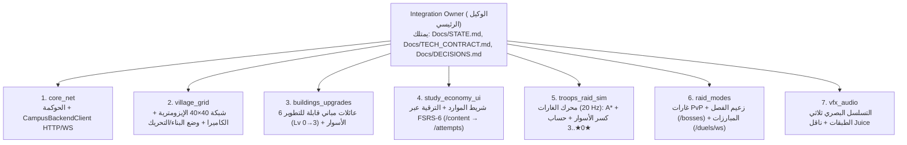

# خطة المعمارية وتوزيع مهام الوكلاء — CampusLingo: Village Clash (قرية المعرفة القابلة للتطوير)

هذه الخطة تستخرج **المعمارية الهندسية، منهجية ذاكرة المستودع (`Repo-as-Memory`)، بوابات التحقق (`M0` ← `M5`)، وتوزيع مهام الوكلاء (`Subagent Task Distribution`)** من حزمة `Autonomous-Godot-Agent-Kit.zip`، وتُخصّصها بالكامل لبناء **لعبة قرية إيزومترية قابلة للتطوير والغارات بأسلوب Clash of Clans** داخل `/home/mahdi/campuslingo-v2/apps/godot/` ومربوطة بخادم `campuslingo-server` (`http://127.0.0.1:18080`)، **دون نسخ لعبة المنصات (`Super Mak 64` / 3 عوالم × 8 مهمات / فيزياء القفز)** التي كانت مجرد مثال في الحزمة.

> [!IMPORTANT]
> **الاعتماد وتقسيم الوحدات الدقيقة (`M0` ← `D016`):**
> بعد اعتمادك البدء في البوابة `M0` وطلبك تقسيم كل جزء لسهولة الـ debugging والتخصيص، تم اعتماد هيكل **40 وحدة دقيقة معزولة (`Micro-Sections: SEC-*`)** موزعة على المسارات السبعة داخل [`Docs/SECTIONS_REGISTRY.md`](../../apps/godot/Docs/SECTIONS_REGISTRY.md)، بحيث يكون كل مبنى، برج دفاع، جندي، نافذة واجهة، ومتحكم كاميرا في ملف مستقل (`<= 150` سطر) مع مفتش مباشر داخل اللعبة (`F2` — `SEC-UI05`) وأمر فحص عبر سطر الأوامر (`python3 tools/godot.py sections`).

---

## 1. كيف استخلصنا منهجية الحزمة وخصّصناها للعبة القرية؟

| عنصر المنهجية في `Autonomous-Godot-Agent-Kit` | التخصيص لمشروع **CampusLingo: Village Clash** |
| :--- | :--- |
| **ذاكرة المستودع (`CLAUDE.md`, `AGENTS.md`, `TASK.md`, `CONTINUE.md`, `Docs/STATE.md`, `Docs/DECISIONS.md`)** | تبقى كما هي في المنهجية: استئناف أي جلسة خلال أقل من 5 دقائق من الملفات مباشرة مع سجل قرارات متسلسل (`D001` ← `D015`). |
| **عقد الملكية الصارم (`Docs/TECH_CONTRACT.md`)** | نستبدل مسارات المنصات (`player jump`, `w1_builder`, `w2_builder`, `w3_builder`) بـ **7 مسارات معزولة لقرية Clash of Clans**: `core_net`, `village_grid`, `buildings_upgrades`, `study_economy_ui`, `troops_raid_sim`, `raid_modes`, `vfx_audio`. |
| **التشغيل عبر سطر الأوامر وحماية العتاد (`tools/godot.py`, `RunGovernor`, `DevTools`, `StoryCam`)** | تُكيَّف لنظام Linux (`/home/mahdi/.local/bin/godot`) مع سقف **نسخة Godot واحدة كحد أقصى (`MAX_INSTANCES = 1`)** لأن الجهاز يملك نواتي CPU و11 GB RAM، والاعتماد على `--headless` والتقاط `StoryCam_A..D`. |
| **المرجع الرقمي أولاً (`rea-physics-reverse`)** | بدلاً من `MOVEMENT_REFERENCE.md` (فيزياء القفز)، نُنشئ **`Docs/VILLAGE_AND_RAID_SPEC.md`** يحدد أرقام الشبكة الإيزومترية (`40×40` خلية)، زوايا الكاميرا، جداول ترقية المباني، أوزان مسار `A*` للجنود، وثوابت التسوية الحقيقية في `crates/domain/src/raids_leagues.rs` و`shields.rs`. |
| **حلقة النقد الرباعية (`critique-fix-loop`) وبوت الإنهاء** | تُخصّص العدسات الأربع لتدقيق: (1) المزامنة الشبكية مع الخادم، (2) سلاسة الكاميرا الإيزومترية وبناء القرية، (3) توازن تطوير القرية مع مراجعات `FSRS-6`، (4) التمييز البصري لمستويات المباني، يتبعها بوت ينفذ دورة بناء وترقية وغارة 3★ تلقائياً. |

---

## 2. توزيع مهام الوكلاء الفرعيين (7 مسارات معزولة في `Docs/TECH_CONTRACT.md`)

يعمل الوكيل الرئيسي كـ **Integration Owner** (يمتلك `Docs/TECH_CONTRACT.md`, `Docs/STATE.md`, `Docs/DECISIONS.md`)، ويوزّع العمل على **7 وكلاء فرعيين** بملكية ملفات غير متداخلة:

| المسار (Track) | المجلدات المملوكة حصرياً | نطاق العمل المخصص لقرية CampusLingo |
| :--- | :--- | :--- |
| **`core_net`** | `project.godot`, `scripts/core/`, `scripts/net/`, `scenes/boot/` | حوكمة `RunGovernor`/`DevTools`، وإدارة الاتصال الحي بـ `campuslingo-server` عبر `CampusBackendClient` (`scripts/backend_client.gd` الحالي). |
| **`village_grid`** | `scripts/village/`, `scenes/village/` | الشبكة الإيزومترية `40×40` خلية (1.5م للخلية)، كاميرا Pan/Zoom بزوايا Clash of Clans (`Pitch 45°`, `Yaw 45°`)، وضع التعديل والسحب والتحقق من عدم التداخل، ومناطق نشر الجيش على المحيط. |
| **`buildings_upgrades`** | `scripts/buildings/`, `scenes/buildings/` | 6 عائلات مباني متطورة: `Core Archive (Town Hall 4×4)`، مجمعات ومخازن الموارد (`3×3`)، 4 أنواع أبراج دفاعية (`Quill Archer`, `Ink Cannon`, `Rune Mortar`, `Hidden Proctor Tesla`)، الأسوار المتصلة آلياً (`1×1`)، الثكنات، وقلعة العشيرة + قباب الدرع. |
| **`study_economy_ui`** | `scripts/ui/`, `scenes/ui/` | واجهة القرية (الذهب، طاقة Focus، الكؤوس، الدرع)، متجر البناء، ونافذة الدراسة والترقية المرتبطة بـ `/v1/courses/{id}/content` و`/v1/attempts/{id}/answer`. |
| **`troops_raid_sim`** | `scripts/troops/`, `scripts/combat/`, `scenes/troops/`, `tests/` | 5 وحدات جيش + البطل (`Field Scholar Hero`) في محاكاة `20 Hz`: النشر المحيطي، البحث عن المسار `A*` مع وزن تكلفة عبور السور (`12.0` مقابل `1.0`)، أولويات الاستهداف، ونسبة الدمار (`0★` ← `3★`). |
| **`raid_modes`** | `scripts/modes/`, `scenes/modes/` | ربط المحرك بأطوار الخادم: غارات PvP (`/raids/scanner`, `/raids/start`, `/raids/settle`)، غارة زعيم الفصل (`/bosses`), والمبارزة الحية (`/duels/ws`). |
| **`vfx_audio`** | `assets/shaders/`, `scripts/fx/`, `scenes/fx/`, `assets/audio/` | التظليل الإيزومتري المشرق بثلاث طبقات، أضرار `Brownout` الدخانية، مؤثرات الترقية والتدمير والقباب الدرعية عبر `Juice Bus`. |

---

## 3. بوابات التنفيذ المرحلية (`M0` ← `M5`)

| البوابة | الهدف الأساسي | معيار الاجتياز (`Verification Gate`) |
| :--- | :--- | :--- |
| **`M0: Tooling & Governance`** | اعتماد الوثائق، تكييف `tools/godot.py` لنظام Linux، وقفل `MAX_INSTANCES=1` مع `RunGovernor` و`StoryCam_A..D` | نجاح الفحص headless دون أخطاء، والتقاط صورة مرجعية ومقطع 10 ثوانٍ |
| **`M1: Village Grid & Raid Math Lab`** | بناء مشهد مختبر الشبكة والقتال وتطبيق معادلات `Docs/VILLAGE_AND_RAID_SPEC.md` | نجاح 100% من اختبارات `tests/run_village_tests.py` (وضع المباني، `A*`، الضرر، ومطابقة `raids_leagues.rs` بتسامح ±3%) |
| **`M2: Parallel Track Foundations`** | بناء المسارات السبعة المعزولة بالتوازي (بحد أقصى وكيلان متزامنان) | اجتياز كل مسار لفحص headless وتسجيل لقطة `lookdev` |
| **`M3: Upgradable Village + Raid/Boss Loop`** | دمج القرية الإيزومترية الكاملة مع الغارات الحية وزعيم الفصل عبر الخادم | تحميل القرية وغارة PvP والزعيم مع توثيق `StoryCam_A..D` |
| **`M4: 4-Lens Critique-Fix & Bot Run`** | 4 وكلاء نقد مستقلين + إصلاح العيوب الحرجة + بوت تلقائي يبني ويذاكر ويهجم 3★ | تحسن درجات اللجان الأربع ونجاح دورة البوت الكاملة |
| **`M5: Linux Release Candidate`** | ضغط الأصول والتصدير المستقل لنظام Linux | إقلاع النسخة المصدّرة بأصفار أخطاء |

---

## 4. الملفات التي سيتم إنشاؤها في هذه المرحلة (التخطيط والحوكمة فقط)

داخل `/home/mahdi/campuslingo-v2/apps/godot/`:
- [`CLAUDE.md`](../../apps/godot/CLAUDE.md) و[`AGENTS.md`](../../apps/godot/AGENTS.md) و[`TASK.md`](../../apps/godot/TASK.md) — قواعد التشغيل والبوابات المخصصة للقرية.
- [`Docs/DECISIONS.md`](../../apps/godot/Docs/DECISIONS.md) — سجل القرارات المتسلسل `D001` ← `D016`.
- [`Docs/SECTIONS_REGISTRY.md`](../../apps/godot/Docs/SECTIONS_REGISTRY.md) — سجل الـ 40 وحدة دقيقة (`SEC-C01`..`SEC-FX03`) بحيث يعيش كل مكوّن في ملف معزول لسهولة التشخيص والتعديل.
- [`Docs/DESIGN_V2.md`](../../apps/godot/Docs/DESIGN_V2.md) — وثيقة تصميم القرية القابلة للتطوير، المباني الـ 6، الجنود الـ 5 + البطل، الغارات، ولوحات الألوان Hex.
- [`Docs/VILLAGE_AND_RAID_SPEC.md`](../../apps/godot/Docs/VILLAGE_AND_RAID_SPEC.md) — المرجع الرقمي لبوابة `M1` والمطابق لثوابت الخادم.
- [`Docs/TECH_CONTRACT.md`](../../apps/godot/Docs/TECH_CONTRACT.md) — عقد ملكية الملفات للمسارات السبعة وواجهات التفاعل.
- [`Docs/STATE.md`](../../apps/godot/Docs/STATE.md) و[`CONTINUE.md`](../../apps/godot/CONTINUE.md) — ضبط نقطة الانطلاق وتنفيذ البوابة `M0`.

---

## 5. خريطة الـ 40 وحدة دقيقة (`Micro-Sections: SEC-*`) داخل المسارات السبعة

| المسار (Track) | معرّفات الأقسام (`SEC-*`) | الوحدات المعزولة (ملف مستقل `<= 150` سطر لكل وحدة) |
| :--- | :--- | :--- |
| **`core_net` (6)** | `SEC-C01`..`SEC-C06` | `RunGovernor`، `DevTools`، `SectionRegistry`، وثلاث شرائح API (`AuthCourses`، `VillageStudy`، `RaidsDuels`) |
| **`village_grid` (5)** | `SEC-G01`..`SEC-G05` | `GridMath`، `GridBoardRenderer`، `CameraPanZoom`، `BuildDragPlacement`، `LayoutPersistence` |
| **`buildings_upgrades` (10)** | `SEC-B01`..`SEC-B06` + `SEC-D01`..`SEC-D04` | مبنى كل عائلة في ملف مستقل (`CoreArchive`, `GoldMine`, `FocusExtractor`, `WallTile`, `Barracks`, `ClanHallShield`) + 4 أبراج دفاعية (`QuillArcher`, `InkCannon`, `RuneMortar`, `HiddenProctor`) |
| **`study_economy_ui` (5)** | `SEC-UI01`..`SEC-UI05` | `ResourceTopBar`، `BuildingActionBar`، `StudyFlashcardDrawer`، `ArmyTrainingDrawer`، `SectionDebugInspector` (`F2`) |
| **`troops_raid_sim` (8)** | `SEC-SIM01`..`SEC-SIM02` + `SEC-T01`..`SEC-T06` | `AStarWallPathfinder`، `RaidTickStarSolver`، و5 جنود + البطل (`SquireFootman`, `LexiArcher`, `ThesisBreaker`, `FormulaGiant`, `GlyphDrake`, `FieldScholarHero`) |
| **`raid_modes` (3)** | `SEC-M01`..`SEC-M03` | `PvpRaidController`، `BossRaidController`، `LiveDuelController` |
| **`vfx_audio` (3)** | `SEC-FX01`..`SEC-FX03` | `JuiceEventBus`، `ToonHierarchyMaterial`، `CombatBuildParticles` |
