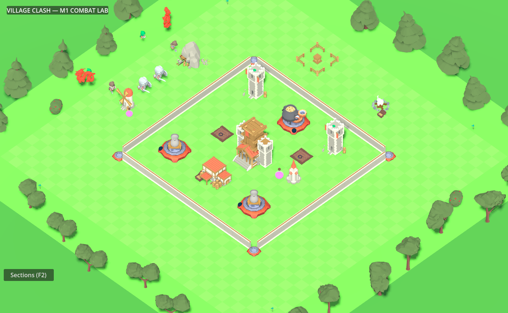
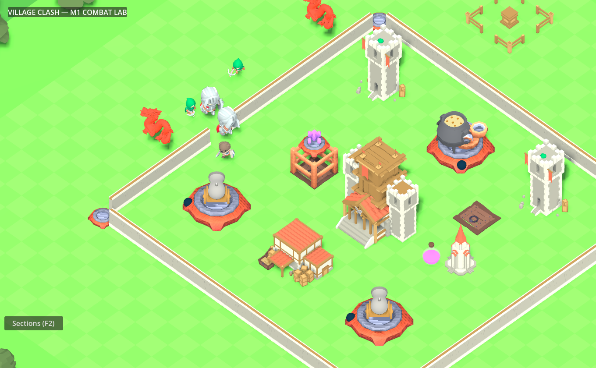
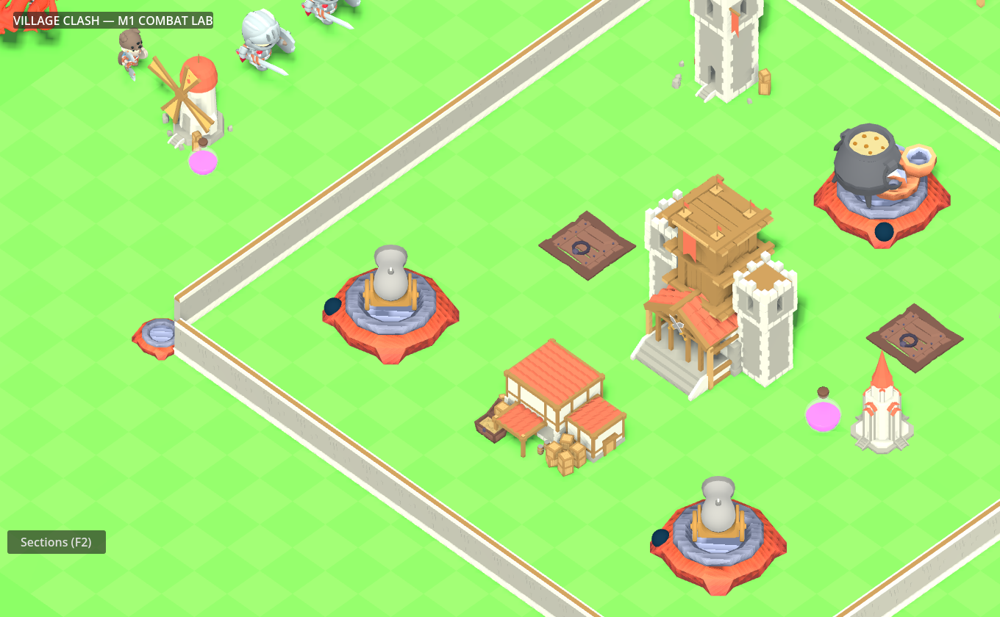

# المعرض البصري المحدّث ومراجعة الأصول (`M1 Critique-Fix Round 2`) — CampusLingo: Village Clash

تم تطبيق **حلقة المراجعة الرباعية (`4-Lens Critique-Fix Loop`)** من الحزمة الأساسية على مشهد `CombatLab` وتصحيح أبرز ملاحظات الإضاءة والخامات، لتصبح جميع الأصول جاهزة الآن **لمراجعتك واعتمادك عنصراً بعنصر** قبل قفل أي مجسم.

---

## 1. اللقطات المحدّثة بعد الجولة الأولى من الإصلاح (`StoryCam_A / D / B`)

````carousel

<!-- slide -->

<!-- slide -->

````

- 🎬 **مقطع المحاكاة:** [m1_combat_lab.mp4](../../apps/godot/Docs/progress/m1/m1_combat.mp4)

---

## 2. ملخص حلقة المراجعة الرباعية (`4-Lens Critique-Fix Loop`)

| العدسة | الملف | تقييم الجولة 1 | المشاكل المرصودة والإصلاحات المنفذة في [`grid_math.gd`](../../apps/godot/scripts/village/grid_math.gd) و [`combat_lab_scene.gd`](../../apps/godot/scripts/combat/combat_lab_scene.gd) |
| :--- | :--- | ---: | :--- |
| **QA & Physics** | [r1_qa/REPORT.md](../../apps/godot/Docs/progress/critique/v1/r1_a/REPORT.md) | `9.0 / 10` | اجتياز `7/7 M1` + `10/10 REA Parity` + تقسيم `14/14` ملفاً (`<= 150L`)، وإضافة لقطة `StoryCam_B` القريبة. |
| **Game Feel & Camera** | [r1_feel/REPORT.md](../../apps/godot/Docs/progress/critique/v1/r1_b/REPORT.md) | `8.0 / 10` | خفض طاقة الشمس (`1.38 → 0.95`) والبيئة (`0.85 → 0.55`) في [`CombatLab.tscn`](../../apps/godot/scenes/tests/CombatLab.tscn) لإزالة الوهج على الدروع والأسوار. |
| **Fun & Level Design** | [r1_fun/REPORT.md](../../apps/godot/Docs/progress/critique/v1/r1_c/REPORT.md) | `7.5 / 10` | استبدال النافورة المسطحة بقلعة مركزية متعددة الأبراج (`barracks_l2.glb + watchtower_l3.glb`) وتلوين قوارير الإكسير. |
| **Visual Hierarchy** | [r1_visual/REPORT.md](../../apps/godot/Docs/progress/critique/v1/r1_d/REPORT.md) | `6.5 / 10` | إزالة اللمعان البلاستيكي (`metallic=0.0, roughness>=0.88`)، تلوين `Liquid_Red` بالبنفسجي `#C83CE6`، وجعل `Glass` شفافاً (`alpha=0.30`). |

---

## 3. قائمة اعتماد الأصول خطوة بخطوة (تُقفل فقط بموافقتك)

> [!IMPORTANT]
> لم يُقفل أي أصل بشكل نهائي؛ القيّم كل فئة أدناه من الصور أعلاه واختر: **معتمد** أو **استبدال بنموذج أكثر واقعية/تفصيلاً (`PBR`)**:

| الفئة | المجسمات الحالية (`res://assets/models/...`) | حالة الملاحظة البصرية | قرارك المطلوب |
| :--- | :--- | :--- | :--- |
| **1. القلعة المركزية (`Town Hall`)** | `barracks_l2.glb` + `watchtower_l3.glb` | تحوّلت إلى قلعة حجرية ببرجين أماميين وبرج مراقبة خشبي علوي (طابع فانتازيا كلاسيكي). | اعتماد أم تغيير؟ |
| **2. الأبراج والأسوار** | `archer_watchtower_l2.glb` · `clash_cannon.glb` · `cauldron_mortar.glb` · `crystal_tesla.glb` · `castle_wall.glb` | مقروءة بوضوح (المدفع، برج الرماة مع الرامي، الهاون/القدر، فتحة التسلا المخفية التي ترتفع عند الاقتراب). | اعتماد أم استبدال؟ |
| **3. الموارد والثكنة (`Barracks`)** | `gold_storage.glb` · `gold_mine.glb` · `elixir_storage.glb` · `elixir_collector.glb` · `elixir_potion.glb` · `town_center_l1.glb` | قوارير الإكسير صارت بنفسجية مضيئة (`#C83CE6`)، **لكن `barracks` (`town_center_l1.glb` في الأعلى يمين) يظهر كسياج ترابي منخفض لا كمبنى مسقوف**. | استبدال الثكنة أم اعتماد البقية؟ |
| **4. الأرضية والغابة** | عشب `GridBoardRenderer` + `pine_tree_1/2.glb` · `oak_tree_1/2.glb` · `moss_rock_1.glb` | مربعات عشب خضراء هادئة بلا خطوط شبكة مع حلقة أشجار صنوبر وبلوط محيطة. | اعتماد أم جعل العشب بنسيج واقعي بدل المربعات؟ |
| **5. القوات ثلاثية الأبعاد (`Troops`)** | `barbarian_footman.glb` · `hooded_archer.glb` · `skeleton_breaker.glb` · `armored_giant.glb` · `clash_dragon.glb` | نماذج KayKit الكرتونية/المبسطة للفرسان والبربري والرامي + التنين الملوّن بالأحمر (`#D9381E`). | الإبقاء أم استبدالها بنماذج بشرية/وحوش واقعية PBR؟ |

---

## 4. بوابة التحقق الآلي (`GATE_M1_TESTS=PASS`)
- فحص السكربتات والمشهد: `[godot.py check] OK — 0 script/runtime errors`
- وحدات القسم المعزول (`14/14` ملفاً `<= 150` سطراً): `grid_math.gd` (`146L`), `combat_lab_scene.gd` (`149L`)
- اختبارات الماكيت والذكاء الاصطناعي (`verify_m1_headless.gd`): **`7/7 PASS`**
- تطابق فيزياء `REA` (`run_movement_tests.py`): **`10/10 PASS`** (ضمن `<= +0.07%`)
